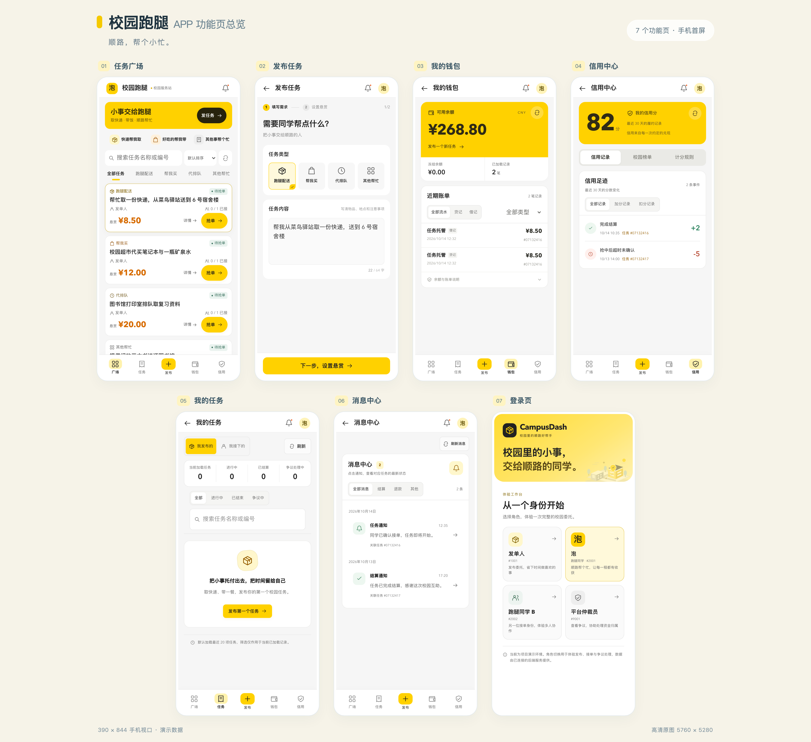

# CampusDash 校园跑腿抢单市场

高级分层架构的并发与一致性工程样本：发单人悬赏（资金托管）→ N 人同时抢、恰好一个成功
→ 限时未确认自动流转 → 送达确认后结算给跑腿与平台。业务链路短，但每个环节都踩在硬骨头上：
抢单正确性可验证（超卖就是错）、资金正确性可验证（借贷不平就是错）。



## 项目结构

```
campus-dash/
├── campus-dash-backend/       # 后端项目（Java/Python + Spring Boot + Maven）
│   ├── dash-domain/           # 领域层：业务规则、领域模型
│   ├── dash-application/      # 应用层：发布/抢单/确认/流转/结算/退款/仲裁/对账编排
│   ├── dash-infrastructure/   # 基础设施层：数据库、缓存、MQ、ShardingSphere 规则、Sentinel
│   ├── dash-presentation/     # 接口层：REST API
│   ├── dash-worker/           # 后台任务：超时流转/自动结算/资金事件消费者、兜底扫描、对账 job
│   ├── dash-bootstrap/        # 应用装配 + 54 个集成测试
│   ├── dash-bench/            # 压测工具
│   ├── dash-shared/           # ErrorCode / Money（long 存分）/ Result / 雪花 ID
│   ├── docker/                # Docker Compose 编排
│   └── docs/                  # 设计文档、分期决策、踩坑记录
└── campus-dash-frontend/      # 前端项目（React + TypeScript + Vite）
    ├── src/                   # 源代码
    │   ├── components/        # 通用组件
    │   └── pages/             # 页面
    └── package.json           # npm 依赖
```

## 环境要求

- JDK 21+（推荐 JDK 21）
- Maven 3.9+（[安装指南](https://maven.apache.org/install.html)）
  - macOS: `brew install maven`
  - Ubuntu/Debian: `sudo apt install maven`
  - Windows: 下载 [binary](https://maven.apache.org/download.cgi) 并配置环境变量
- Docker（MySQL 8 + Redis 7 + RocketMQ 5.3.1，由 docker-compose 管理）
- Node 18+（仅前端需要）

## 快速开始

**推荐用AI（启动提示词如下）**：
> 在编程助手中打开该工程目录，可以使用以下提示：帮我启动这个项目。先阅读 README 和现有配置，检查环境与端口。安装缺失依赖，启动前后端，检查健康接口并完成一次页面请求。缺少配置时说明需要配置哪些字段。最后告诉我访问地址和停止服务的方法。


### 1. 启动后端

启动前，在当前终端设置 `SPRING_DATASOURCE_PASSWORD`；后端、worker、测试与 MySQL Compose 使用同一环境变量，无明文默认口令。可通过 `read -rs SPRING_DATASOURCE_PASSWORD` 静默输入并执行 `export SPRING_DATASOURCE_PASSWORD`，或从仓库外受控环境文件加载。使用 JWT 模式时另需设置至少 32 字节的 `DASH_JWT_SECRET`。不要提交真实 `.env`，不要将展开凭证的 `docker compose config` 输出加入报告；检查配置使用 `docker compose config --quiet`。具体步骤见 [后端凭证配置](campus-dash-backend/docs/凭证配置与发布脱敏.md)。


```bash
cd campus-dash-backend

# 起中间件并初始化（表、topic、消费组）
cd docker && docker compose up -d && sleep 15 && ./init-mq.sh && cd ..

# 跑测试（当前累计 93 个测试；中间件没起时集成测试 skip 而不是 fail）
mvn clean test

# 启动应用（默认 8080，后门关闭，只认 Bearer token）
mvn -pl dash-bootstrap spring-boot:run

# 启动 worker（超时流转 / 自动结算 / 资金事件消费 / 消息重发，另一个终端）
mvn install -DskipTests
java -jar dash-worker/target/dash-worker-1.0.0-SNAPSHOT.jar
```

### 2. 启动前端

```bash
cd campus-dash-frontend

# 安装依赖
npm install

# 启动开发服务器（5173，vite 代理 /api -> 8080）
npm run dev
```

访问 http://localhost:5173，选择演示身份登录：
- 发单人 1001
- 跑腿 2001、2002
- 仲裁员 9001

### API 快速体验（不走前端）

```bash
TOKEN=$(curl -s -X POST localhost:8080/api/auth/login \
  -H 'Content-Type: application/json' -d '{"userId":1001}' \
  | python3 -c "import sys,json;print(json.load(sys.stdin)['data']['token'])")

# 发布（资金同步托管）、抢单、全生命周期操作
curl -s -X POST localhost:8080/api/errands -H "Authorization: Bearer $TOKEN" \
  -H 'Content-Type: application/json' \
  -d '{"title":"帮我带份饭","rewardCents":1500,"slotTotal":1}'
# 详情响应含 availableActions：前端按钮完全由它驱动，不实现第二份状态机
```

### 压测与数据治理

```bash
# S1 尖峰：2000 并发抢 1 名额（应用层与数据库侧双验证）
# S4 资金：500 任务并发结算 / 200 并发结算同一任务（SettleConcurrencyIT）
cd campus-dash-backend && mvn test -Dtest=SettleConcurrencyIT

# 按轮次校验与清理（数据默认保留最近 10 轮，便于改动前后对比）
RUN_ID=<runId> bash bench/scripts/verify_run.sql   # 抢单侧五条不变式
bash bench/scripts/verify_fund.sql                  # 资金侧五条不变式
bash bench/scripts/cleanup.sh --keep-last 10
```

## 核心机制

### 后端架构

- **DDD 洋葱四层（很简单且很有用）**：dash-domain（零框架依赖）→ dash-application → dash-infrastructure → dash-presentation
- **ArchUnit 强制**：领域层不许碰框架、端口定义在领域层、模型不依赖端口

### 抢单五层防护

Sentinel 热点参数限流 → 资格前置（信用分 + 在途任务数）→ Redis Lua 原子判定（名额扣减+幂等）→ MySQL CAS → 双唯一索引兜底。

**对照实验证明**：拆掉任一层都能压出超卖（名额 -499 / 158 人抢中同一名额）。

### 分片策略

- 任务链路表按 `campus_id` 分片
- 账户/信用表按 `user_id` 分片
- ShardingSphere 规则工厂与 class-based 取模算法已纳入测试

### 超时流转 / 自动结算

主通道（MQ 定时消息）追实时、兜底扫描追不丢，靠幂等三件套（version CAS + round 轮次 + msg_key 唯一索引）保证双通道重复执行无副作用。

### 两种消息一致性机制

按"是否需要延迟"分工：
- **要延迟**（确认超时、自动结算）：本地消息表 + 定时消息
- **不要延迟**（资金事件通知）：事务消息（半消息 + 回查）

### 资金三道幂等闸门

escrow 状态 CAS + errand 状态 CAS + wallet_ledger.biz_no 唯一索引。

三层对账（L1 借贷平衡 / L2 快照一致 / L3 托管闭环）兜底。

### availableActions

状态机只存在于领域层，前端操作按钮由后端计算的动作集合驱动，前端零状态机。

### long→string 序列化

雪花 ID 超过 JS 安全整数（2^53），Jackson 全局转 string。

### 前端特性

- **React 18** + TypeScript + Vite 快速构建
- **WebSocket** 实时推送
- **7 个页面**：任务广场、发布任务、我的任务、钱包、信用分、消息、详情

