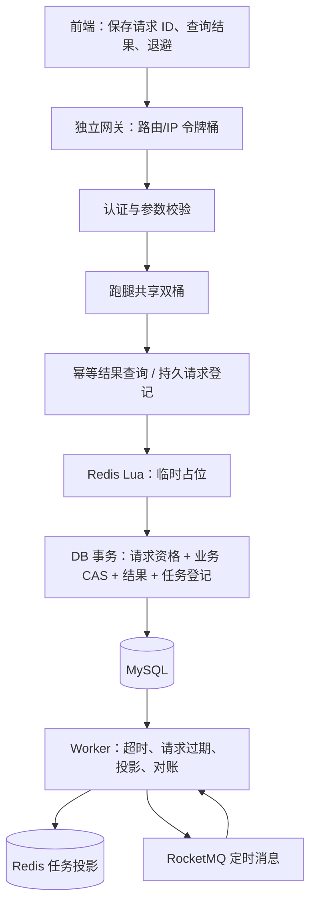
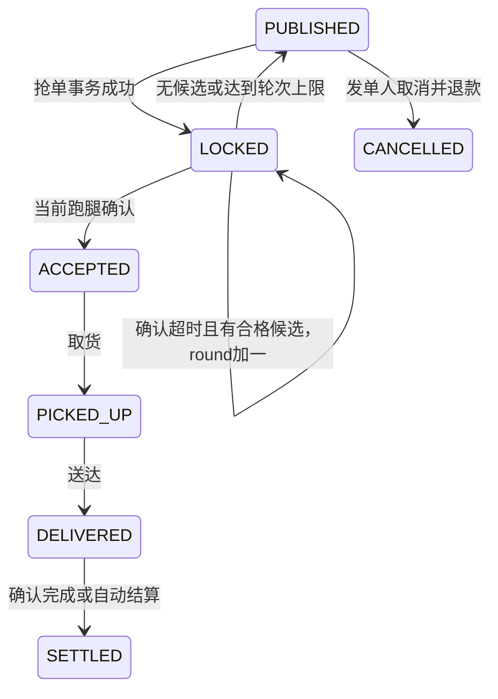

# 幂等、防刷与超时占位恢复技术方案

日期：2026-10-20

状态：实现前评审草案；本文件中的新增能力尚未实现。

范围：校园跑腿抢单链路及其前端、Worker、网关。统一使用“跑腿”称谓。

## 1. 方案摘要

1. **请求幂等以 MySQL 最终结果为准**。新增持久化请求记录，前端重试复用请求 ID；Redis 占位只能表示处理中。业务修改、请求成功结果、首轮超时消息和投影同步任务在同一个数据库事务中提交。
2. **Redis 分开保存已提交状态和临时占位**。以 DB 的 `version/round` 更新任务投影，以请求令牌标识临时占位，取消现有“删一个跑腿成员就 INCR”的回池协议。
3. **故障恢复先撤销旧请求的提交资格，再清理 Redis**。请求过期与补偿任务同事务持久化；旧线程、旧轮次消息和旧补偿均不能改变新一轮业务结果。
4. **防刷分为入口、跑腿和热点任务三层**。增加独立网关令牌桶、跑腿跨实例双桶，保留 Sentinel 的单实例热点任务保护；正式环境关闭任意 `userId` 演示登录。
5. **按正确性、恢复能力、防刷和部署分阶段交付**。先完成幂等与占位恢复闭环，再开放流量；所有阈值均为待验证配置，不沿用历史压测数字作为新方案容量证明。

本方案选择增加数据库请求登记，以换取可恢复的请求身份和明确结果。受准入控制后，每个新逻辑请求都可能读写 DB，不能继续宣称“绝大多数失败请求完全不访问数据库”。Redis 仍减少热点任务行更新及事务竞争。

## 2. 已有能力与本次缺口

以下是本次代码核查结果，不等同于线上运行验证。后端当前采用 Java 21、Spring Boot 3.5.8、JdbcTemplate、Redis Lua、RocketMQ 5.x 客户端、Sentinel 1.8.8。默认数据源直连单库；已有分片规则工厂不代表已完成真实多库装配。

| 项目 | 已有实现 | 本次处理 |
| --- | --- | --- |
| 状态机 | 待抢单、抢中待确认、待取货、配送中、待确认完成、已结算，以及取消、争议、退款 | 复用状态，收紧状态与到期条件，统一变更后的投影同步 |
| 抢单去重 | Lua 按任务和 requestId 去重，DB CAS、名额/跑腿业务唯一索引 | 新增请求级唯一约束、参数绑定和最终结果重放 |
| 前端请求标识 | 抢单未发送 `X-Request-Id`，后端缺省生成随机值 | 同次操作持久化 ID，接口升级为必填 |
| 重复请求返回 | Redis 占位后立即被解释为成功 | 引入 PROCESSING 和已持久化终态 |
| 限流 | 单实例、单任务 Sentinel，默认 500/s | 新增共享跑腿限流、网关入口限流及 HTTP 429 |
| 确认超时 | 默认 300 秒；RocketMQ + 本地消息重发 + DB 超时扫描 | 首轮消息同事务登记，到期校验与竞争保护 |
| 回池 | DB 回退后按当前跑腿调用 Redis rollback | 改为版本化任务投影；修复 A→B 后回池不归还名额 |
| 对账 | 资金对账、详情缓存抽样校验 | 新增独立的抢单占位对账和持久化补偿任务 |
| 登录 | 任意正数 userId 可领取演示令牌 | 环境隔离、正式身份验证入口、禁止默认演示配置进入生产 |

特别需要修复的异常路径：

- `GrabErrandUseCase` 当前 catch 范围包括 DB 提交后的超时登记、缓存和通知操作，这些后置操作异常也会触发 Redis 回滚。
- 首轮超时消息在抢单事务之外登记，进程可能在二者之间退出。
- 超时处理器只检查状态和轮次，没有在最终业务裁决中检查实际到期时间。
- 候选流转只更新 DB，Redis 占位集合仍保存原跑腿；随后按新跑腿归还名额会失败。
- DB 回池成功后 Redis 更新失败，已有只扫描 LOCKED 的任务不能修复 PUBLISHED 的残留占位。
- 文档中“已有占位对账 Job”的描述缺乏对应实现，需要在实现完成后同步修订。

## 3. 范围、业务语义与验收边界

### 3.1 本期范围

| 编号 | 需求 | 优先级 |
| --- | --- | --- |
| F01 | 端到端请求幂等、并发重放、参数冲突拒绝、提交结果未知恢复 | P0 |
| F02 | 修复回池及提交后错误回滚；按轮次、版本、请求令牌隔离旧操作 | P0 |
| F03 | 持久化补偿任务、请求到期扫描、Redis 缺失恢复、占位对账 | P0 |
| F04 | 确认超时的真实到期条件、首轮消息原子登记、重复消息处理 | P0 |
| F05 | 跑腿维度共享限流、标准错误响应、前端退避 | P1 |
| F06 | 独立网关令牌桶与入口边界；正式认证配置守卫 | P1 |
| F07 | 实际身份源接入及故障、并发、迁移验收 | 正式对外开放前必需 |

### 3.2 本期业务决策

- **按一单一位跑腿闭环设计**。当前任务只有一个 `grabber_id`，抢中后状态立即变为 LOCKED，不能把已有 `slot_total > 1` 入参理解为完整多人履约能力。新发布接口限制 `slotTotal=1`；实施前盘点历史多名额任务，阻止其进入新协议并单独处理，不能静默改写历史数据。
- **超时对象是已抢中但未确认的任务**。PUBLISHED 本来就在待抢池中；长期无人抢单自动取消、退款作为可选业务扩展，本期不开启。
- 已接单、取货、配送超时不自动回池，避免两位跑腿同时履约。这类异常仍走业务争议等流程。
- “幂等”保证一次逻辑请求的业务效果和终态重放；“防刷”控制请求频率；“超时”处理业务确认窗口；“恢复”修复跨存储中断。这四项分别验收。
- 有限频率的脚本、批量真实账号协作不由本期限流完全识别。预留风控事件，不新增验证码供应商或设备指纹采集。

### 3.3 不变式

1. 同一任务同一轮只存在一个有效占用者；同一请求最多提交一次业务效果。
2. 任何成功响应都有主库中已提交的请求成功记录及对应业务事实。
3. 请求从 PROCESSING 转为终态后不能恢复为 PROCESSING。
4. 旧轮次、旧版本或已过期执行令牌不能提交新业务，也不能释放新占位。
5. Redis 重建失败时允许短暂拒绝新抢单，不允许猜测成功或无限放流 DB。
6. 在依赖恢复、Worker 正常运行且到达率小于处理能力的条件下，遗留请求和补偿任务最终收敛；不承诺依赖持续不可用时仍可恢复。

## 4. 方案比较与选型

### 4.1 整体方案

| 方案 | 一致性与恢复 | 热路径成本 | 改造量 | 结论 |
| --- | --- | --- | --- | --- |
| A：现有 Lua + 简单 SETNX + 定时补 INCR | 无可靠处理中身份；修复可能误释放在途占位 | 低 | 小 | 不选，无法覆盖本次故障窗口 |
| B：持久请求 + Redis 临时占位/已提交投影 + DB CAS + 补偿任务 | 结果可追溯，旧请求可撤销，可从 DB 恢复 | 新请求增加 DB 登记及终态写入 | 中 | **推荐** |
| C：移除 Redis 占位，全部请求由 DB 裁决 | 一致性最直接，幂等仍需请求表 | 热点任务行竞争和 DB 压力较大 | 中 | 作为对照压测，不作为本期主方案 |

### 4.2 关键组件

| 决策 | 候选方案 | 推荐与理由 |
| --- | --- | --- |
| 请求结果存储 | 仅 Redis；现有 MySQL 请求表 | MySQL，与业务事务同库；Redis 仅缓存已提交终态 |
| Redis 占位结构 | 独立名额数 + 用户集合；单任务 Hash 的 committed/pending 分区 | Hash，避免跨轮次成员身份与 INCR 的耦合 |
| 超时触发 | 重写 Redis 延迟 ZSET；沿用 RocketMQ 定时消息 + DB 扫描 | 沿用，新增真实到期谓词，避免引入第二套业务调度 |
| DB→Redis 同步 | 仅 afterCommit 回调；事务内登记投影/撤销任务 | 后者，回调只作加速，崩溃仍有持久化恢复入口 |
| 跑腿限流 | 本地 Sentinel 参数规则；Redis 原子双桶 | Redis，配额跨实例共享；Sentinel 保留作本机容量保护 |
| 网关 | MVC Filter；独立 Spring Cloud Gateway | 独立 `dash-gateway`，满足真正的网关入口隔离，业务服务继续使用 MVC |
| 正式身份 | 自建密码账号系统；校园 SSO/OIDC 身份验证适配 | 优先身份适配，具体 issuer/映射为部署输入；不扩建账号体系 |
| 扫描任务并发 | JVM 定时器互斥；DB 领取租约与条件更新 | 现有 Spring 调度 + DB 租约，多 Worker 不依赖单机互斥 |

网关采用与 Boot 3.5.x 匹配的 Cloud 2025.0.x / Gateway 4.3.x 系列，实施时锁定兼容补丁版本。网关单独运行，不向现有 MVC 应用混入 WebFlux。版本关系依据 [Spring 官方兼容表](https://github.com/spring-cloud/spring-cloud-release/wiki/Supported-Versions)。

## 5. 总体架构与职责

| 层/模块 | 新增或调整职责 |
| --- | --- |
| `dash-domain` | 请求状态模型；`GrabRequestRepository`、`GrabProjectionPort`、`RunnerRateLimiterPort`、补偿任务端口；保持零框架依赖 |
| `dash-application` | 抢单编排、请求终态查询、过期处理、投影重建；DB 事务拆入独立 Step Bean |
| `dash-infrastructure` | JDBC 表操作、Lua、Redis 限流、身份验证适配；所有 Redis/MQ IO 在业务事务之外 |
| `dash-presentation` | API 契约、HTTP 状态码、CurrentUser 绑定、CORS、正式/演示登录入口 |
| `dash-worker` | 领取和处理持久任务、过期请求扫描、占位对账、原有超时扫描 |
| `dash-gateway` | 新增独立模块/进程，只做入口路由与保护，不加载业务 DB |
| 前端 | 请求 ID 生命周期、202/429/503 处理、恢复查询、刷新最新可操作状态 |

所有涉及任务状态、轮次、占用者、名额的写入都必须递增 DB `version`，并登记同一版本的投影同步任务，包括发布、抢单、流转、回池、确认、取货、送达、取消、争议、结算和退款。不能只修抢单方法而遗漏其他写入口。

## 6. 数据设计

### 6.1 新增 `grab_request`

作用域定义为 `(campus_id, runner_id, operation, request_id)`。同一作用域复用 ID 但修改任务或轮次，返回冲突；不同跑腿互不影响。不同校区为不同作用域，不宣称跨分片全局唯一。

| 字段 | 类型/约束 | 说明 |
| --- | --- | --- |
| `id` | BIGINT PK | 服务端请求记录 ID，跨 JS/Lua 边界保持字符串 |
| `campus_id / errand_id / runner_id` | BIGINT NOT NULL | 校区必须从任务事实核实；身份来自认证上下文 |
| `operation` | VARCHAR(24) NOT NULL | 本期固定 GRAB |
| `request_id` | VARCHAR(64)，ASCII 大小写敏感 | 前端生成 UUID，严格校验，不接受任意超长值 |
| `payload_hash` | CHAR(64) | 规范化的任务、校区、动作、expectedRound 的 SHA-256 |
| `request_round / base_errand_version` | INT / BIGINT | 绑定本次尝试，执行时不可换成当前最新轮次 |
| `status` | VARCHAR(16) | PROCESSING / SUCCEEDED / REJECTED / EXPIRED |
| `reservation_token` | CHAR(36) | 服务端随机执行令牌，仅首次创建者持有 |
| `lease_until` | DATETIME(3) | DB 时间签发的固定执行截止时间；重试不得续期 |
| `result_code / http_status / result_json` | VARCHAR / SMALLINT / JSON | 终态响应快照，包含 requestId、appliedRound，不承诺候选入队成功或固定排名 |
| `created_at / completed_at` | DATETIME(3) | 登记及完成时间 |

索引：唯一 `(campus_id, runner_id, operation, request_id)`；过期扫描 `(status, lease_until, id)`；按任务排查 `(campus_id, errand_id, status)`。

本期不做同一请求执行权接管和续租。PROCESSING 的重复请求只查询；到期后形成 EXPIRED 终态，用户在确认结果后发起新逻辑操作才使用新 ID。这样无需同时引入可变 attempt epoch 和续租协议。

Redis 终态缓存初值 24 小时；本期不物理删除 DB 请求记录和唯一键。后续可在任务终态 30 天后归档结果正文，但必须在在线表保留唯一键、任务/轮次、指纹、终态及归档引用，形成永久的轻量唯一守卫。归档后的查询读取归档结果或返回结果已归档；同 ID 改任务/改轮次仍返回冲突，不能因删除原行而重新执行业务。归档期限为待确认的运维参数，归档系统本期不新增。

### 6.2 新增 `grab_repair_task`

这张表既承载状态变更后的 Redis 投影任务，也承载请求撤销后的占位清理。它不复用延迟 MQ 的 `local_message`，避免把“已发送消息”和“已修复 Redis”混为同一种完成状态。

| 字段 | 类型/约束 | 说明 |
| --- | --- | --- |
| `id / campus_id / errand_id` | BIGINT | 定位及共片键 |
| `event_key` | VARCHAR(192) UNIQUE | APPLY 用任务+版本；REVOKE 用请求记录+令牌 |
| `event_type` | VARCHAR(24) | APPLY_PROJECTION / REVOKE_PENDING |
| `target_version / round` | BIGINT / INT | 目标业务快照版本及轮次 |
| `request_db_id / reservation_token` | BIGINT / CHAR(36)，可空 | 撤销事件必须携带 |
| `payload` | JSON | 投影快照或撤销身份；投影缺失重建必须重新读主库 |
| `status` | VARCHAR(16) | PENDING / RUNNING / DONE / DEAD |
| `next_run_at / retry_count` | DATETIME(3) / INT | 有界重试和退避 |
| `worker_token / locked_until` | VARCHAR / DATETIME(3) | Worker 领取租约 |
| `last_error / created_at / updated_at` | VARCHAR / DATETIME(3) | 排障与审计 |

索引：`(status, next_run_at, id)`、`(status, locked_until, id)`。完成/重试更新必须匹配 `worker_token`，过期 Worker 不得完成后来 Worker 领取的任务。

仓储提供 `ensureRepairPending`：首次事件创建任务；再次发现同一版本或 token 的差异时，条件重开 DONE；不抢占有效 RUNNING；DEAD 告警并提供受控重放。不能用 `INSERT IGNORE` 把去重实现成“一个版本只允许修复一次”，APPLY 和 REVOKE 均适用。

### 6.3 调整现有数据

- `errand` 增加 `confirm_deadline DATETIME(3)` 和索引 `(status, confirm_deadline, id)`。抢中及候选流转时由 DB 时间写入；确认、回池后清空。活跃巡检补充索引 `(campus_id, status, id)`。
- `grab_record` 保留两条业务唯一索引，增加可空的 `request_record_id` 并建立唯一约束；历史记录为 NULL，不伪造历史 requestId。
- 候选接管时同事务登记新轮次的占用事实，避免仅改 `grabber_id`、历史记录却无法解释新占用者。旧轮次记录保留，不跨轮次覆盖。
- `local_message` 补充 `campus_id`，迁移阶段允许旧行缺省，回填核验后再收紧约束；新增消息 payload 携带协议版本、校区、任务、轮次、版本、截止时间。首轮与后续轮次消息均与业务状态共事务。
- 新增轻量 `grab_audit_cursor`，保存 `(job_name, campus_id, task_status)` 唯一键、`last_id/upper_id/cycle_started_at/version`。巡检按固定上界推进，检查后再更新水位；崩溃最多重复检查，不能跳过尚未检查的数据。
- 当前单库先落地。未来真实分片时，任务、请求、抢单记录、状态日志、相关本地消息和补偿任务按 `campus_id` 共片；所有读写必须有可核验路由。否则不得宣称同一个本地事务覆盖这些表。

### 6.4 Redis v2 模型

本期单名额任务使用一个 Hash：`dash:grab:v2:{errandId}:state`。

| 区域 | 字段 | 写入来源 |
| --- | --- | --- |
| 初始化 | `mode=INIT/READY`、`buildToken`、`buildUntil` | 受令牌保护的重建流程 |
| 已提交投影 | `dbVersion`、`round`、`status`、`slotTaken`、`ownerRunnerId` | DB 已提交快照 |
| 临时占位 | `requestDbId`、`reservationToken`、`baseVersion`、`pendingRound`、`runnerId`、`leaseUntil` | 已持久登记请求的 Lua acquire |

可抢条件是投影为 PUBLISHED、DB 已占名额为 0、无有效 pending。**不再使用 INCR/DECR 修正回池数量**。DB 仍保留名额约束，Redis 可用性由上述字段推导。

辅助键：

- `dash:grab:v2:{errandId}:result:{runnerId}:{requestId}`：已提交终态缓存。
- `dash:grab:v2:{errandId}:revoked:{requestDbId}:{reservationToken}`：撤销墓碑。
- 候选队列保留现有能力，重复入队使用成员唯一及 `ZADD NX`，不因同请求重试重置排队时间。

同任务键均使用相同 hash tag，Lua 所需键显式传入 `KEYS`。不同任务、跑腿限流桶、网关桶不要求处于同一个 Redis slot。

## 7. 请求幂等与抢单流程

### 7.1 外部接口

| 接口 | 契约 |
| --- | --- |
| `POST /api/errands/{errandId}/grab` | 必填 `X-Request-Id`、body `expectedRound`；runnerId 取 CurrentUser，campusId 从任务核实 |
| `GET /api/errands/{errandId}/grab-requests/{requestId}` | 仅查询当前认证跑腿的请求；独立查询额度；恢复网络未知结果 |
| 原详情接口 | 继续返回当前 round、status、availableActions，供发起操作和重放后刷新 |

服务端不再为缺失 ID 的 v2 请求补随机 UUID。请求体、路径与保存指纹不符返回 409，不执行业务。不存在的查询返回 `REQUEST_NOT_FOUND`，不据此认定前一次写请求一定没有提交。

| HTTP | 业务语义 | 客户端动作 |
| --- | --- | --- |
| 200 | 已持久化成功，或原成功结果重放 | 刷新详情，区分历史 appliedRound 与当前轮次 |
| 202 | PROCESSING 或提交结果尚未知 | 带 Retry-After 轮询查询，禁止创建新 ID 盲重抢 |
| 409 | 指纹冲突、旧轮次、名额冲突等明确业务终态 | 展示业务结果；新轮次由用户发起新操作 |
| 400/401/403 | 参数、认证、权限错误 | 不自动重试 |
| 429 | 准入频率超限 | 保留原 ID，按 Retry-After 退避 |
| 503 | 依赖或恢复流程暂不可用 | 保留原 ID，先恢复查询；不视作业务失败终态 |

现有 `Result` JSON 包装保留，增加 `requestId/status/appliedRound/replayed/retryAfterMillis`。请求终态只描述此次抢单结果，不承诺候选入队成功或固定排名；如前端显示候选状态，独立查询当时的队列状态。

### 7.2 前端生命周期

1. 用户点击一次抢单时生成 UUID，并保存 `{userId, errandId, expectedRound, requestId, createdAt}`。
2. 网络超时、202、429、503 继续使用该 ID；刷新页面后优先查询未决请求。使用按身份隔离的 sessionStorage，切换账号不复用其他账号的记录。
3. UUID 与 expectedRound 在同次操作中不可重新生成；已知终态后，用户主动发起新的尝试才生成新 ID。
4. 自动重试使用有限次数、指数退避及抖动；初值最多 3 次，之后提示用户查询/重试。重复点击禁用只改善体验，不作为后端保障。
5. 成功重放表示过去该请求成功，不表示当前仍由该跑腿占有；必须刷新详情后展示当前 availableActions。

### 7.3 服务端顺序

1. 网关预算、认证、参数校验、跑腿双桶。
2. 查询可信终态缓存；未命中从主库查询 `grab_request`。缓存只能在 DB 提交后写入，必须保存 campusId、runnerId、operation、errandId、requestRound、payloadHash 及终态结果，命中时仍核对当前参数；不把未提交 PROCESSING 当作可信成功缓存。校验身份、路径与指纹后，终态直接重放，PROCESSING 返回 202。
3. 对新请求执行本地热点容量保护与基本资格校验；准入拒绝不创建请求或占位。确定任务校区、轮次和版本。
4. 独立 `GrabRequestBeginStep` 尝试插入 PROCESSING，生成固定 `reservationToken/leaseUntil`。唯一冲突转查询，只有成功创建者进入执行。
5. Redis Lua acquire：核对 READY、baseVersion、round、可抢状态、墓碑及 leaseUntil，原子写 pending。Redis 只返回 ACQUIRED、BUSY、STALE、REPAIR_REQUIRED 等，不返回业务成功。
6. ACQUIRED 进入独立 `GrabCommitStep`。先锁请求行，拿到锁后读取 DB 时间，再校验 PROCESSING、令牌和 leaseUntil；复核业务资格及期望轮次。
7. 同事务完成任务 CAS、grab_record、状态日志、请求 SUCCEEDED 结果、首轮超时 local_message、APPLY_PROJECTION 任务。任务 CAS 必须同时带 PUBLISHED、expectedRound、expectedVersion 及名额条件。
8. 最终更新请求成功状态仍带 PROCESSING、token、`lease_until > DB 当前时间` 条件；失败则回滚整个业务事务。
9. 提交成功后可尝试立即同步 Redis/发 MQ，以减少延迟。失败仅等待持久任务重试，不改变已提交成功结果，不回滚业务占位。

Lua 未获得名额且结果明确时，通过独立 `GrabRequestFinishStep` 将请求设为 REJECTED，并同事务登记必要的 REVOKE_PENDING。首次未获名额的路径尽力执行 `ZADD NX` 入候选队列，异常只记录告警，不改变请求终态；终态重放不重复入队。本期不保证该副作用在进程退出后恢复，也不返回“已可靠入队”。若后续要求完整候选资格恢复，必须增加同事务登记的 ENQUEUE_CANDIDATE 任务及队列代次校验，不能仅在重放时无条件重新入队。

PROCESSING 期间校验失败、可确定的事务回滚也由该 Step 落终态。同一请求的业务 Step、终结 Step、过期 Step 竞争同一请求行锁：先成功提交的一方决定终态。

### 7.4 提交结果未知

数据库连接异常不能证明事务未提交。查询主库：

- SUCCEEDED：重放成功，补投影。
- REJECTED/EXPIRED：返回该终态，补撤销。
- PROCESSING：返回处理中，等待该事务完成或到期裁决。
- DB 不可达：返回 503，保留请求身份，不提前清 Redis。

对 `lockAndRecord` 之后发生的缓存、消息、通知异常单独处理。禁止继续使用包围整个抢单流程的“catch 任意异常就 rollback Redis”结构。

## 8. Redis 条件操作与恢复协议

### 8.1 acquire

- 请求必须已有持久记录及服务端签发令牌、固定 deadline。
- 使用 Redis TIME 做挡板到期检查；DB 时间决定真正的提交资格。两者偏差只影响暂时准入，不能成为业务成功依据。
- `INIT`、投影版本/轮次不符、撤销墓碑存在均拒绝占位。
- 重复 token 返回处理中，不刷新 lease、不重复占位。
- pending 看似过期时返回 REPAIR_REQUIRED；不能只凭 Redis TTL 自行宣告业务失败。

### 8.2 applyProjection

版本由 DB `errand.version` 产生，所有写入口统一遵守，禁止 Redis 自行生成业务版本。

| 输入版本与当前版本关系 | 操作 |
| --- | --- |
| 更小 | 忽略旧快照并完成该过时事件 |
| 相等 | 内容一致则幂等返回，保留 pending；内容不同报警并从主库复核，普通事件不得直接覆盖 |
| 更大 | 更新 committed；仅清除 baseVersion 更小或轮次已失效的 pending |
| 状态键缺失/INIT | 返回需要重建/重试，不能直接用旧 outbox payload 初始化 |

A→B 候选流转后，新版本投影的 `ownerRunnerId` 就是 B；回池新版本是 PUBLISHED、owner 空、slotTaken=0。不依赖 Redis 里能否删除 B 来决定归还名额。

### 8.3 revokePending

撤销条件包含 `requestDbId + reservationToken + pendingRound + baseVersion`，只清匹配 pending，不修改 committed。

即使 pending 不存在，也写撤销墓碑，阻止暂停的旧线程在清理后才进入 acquire。墓碑至少保留到原 leaseUntil 加配置的时钟偏差与安全余量；旧请求不能续租。Redis 丢失墓碑时，固定截止时间与 DB 请求终态仍保护业务，发现短暂脏占位由修复再次清理。

不能承诺 Redis 与 MySQL 跨存储线性一致。允许缓存暂时滞后导致拒绝；禁止因此产生额外业务成功。

### 8.4 请求到期

按 `(status, lease_until, id)` 分批扫描 PROCESSING：

1. `GrabRequestExpireStep` 锁请求行，锁后取 DB 时间。
2. 未到期不处理；已成功不改；到期且仍 PROCESSING 才更新 EXPIRED。
3. **EXPIRED 与 REVOKE_PENDING 任务在同一事务提交**，避免“请求已经过期但还没清 Redis”时宕机，之后再也扫不到。
4. Worker 提交事务后清理 Redis，失败继续重试。旧执行线程之后尝试提交，会被请求状态/令牌/截止时间条件挡住。

### 8.5 Redis 缺失重建

1. 对缺失任务键通过 Lua 建立 INIT 和随机 buildToken，初始化本身有截止时间。
2. 在事务外从主库读取当前任务快照；初始化期间新抢单返回短暂 503。
3. 仅持有当前 buildToken 的重建者可发布 READY；旧重建者不能覆盖后来者。
4. INIT 期间投影事件不确认完成，保留重试；初始化后更高 DB 版本继续推进。
5. 缺失重建不得直接拿历史事件 payload 设成最新状态。READY 仍可能短暂落后于并发 DB 提交，由任务重试收敛，最终抢单继续由 DB CAS 裁决。

### 8.6 占位对账

发现来源必须独立于 Redis：

- 过期 PROCESSING 请求索引；
- 未完成/领取超时的 `grab_repair_task`；
- 对活跃任务按校区、主键游标有界扫描的 DB→Redis 校验；
- 请求访问时发现 missing、INIT 超时或版本不一致触发按需修复。

巡检逐校区、逐活跃状态使用 `id > last_id AND id <= upper_id ORDER BY id LIMIT batch`，每轮开始固定 upperId；轮末重置水位进入下一轮，轮中新增或状态变化的任务由下一轮及 outbox 覆盖。未来真实分片时逐物理分片维护水位和处理预算，不能广播查询后只取一个全局 LIMIT。

对账读到 pending 后，查询其持久请求。正在处理且未到期时保留；已成功时同步当前 DB 投影；失败或到期时走撤销协议；不认识的历史 pending 进入迁移/人工诊断路径，不能无限加名额。

同版本字段不符先报警并从主库复核，再由专用 repair 操作仅校准 committed；Lua 仍检查版本不曾推进，不能一并清 pending。正常同版本重放先保留 pending，审计再核实其请求仍为 PROCESSING、未到期且 baseVersion/round 匹配；不匹配的旧 pending 走请求终态裁决及持久撤销，不能永久保留。审计通过 `ensureRepairPending` 重开需要重复修复的 DONE 任务；RUNNING 任务保留现有领取者，旧事件不得改写新版本。扫描结果落差异日志，记录前后版本、请求、动作、原因及 taskId。

Worker 分批领取时短事务使用条件更新或 `FOR UPDATE SKIP LOCKED`，领取后提交再调用 Redis。超时 RUNNING 任务重新领取，完成更新要求 workerToken 匹配。DB 锁不跨外部 IO。

## 9. 确认超时与回池

图仅展示本次相关主路径，争议/仲裁保持现有业务规则；不新增“已接单后自动取消”分支。

- 抢中事务用 DB 当前时间写 `locked_at/confirm_deadline`，并同事务登记 timeout 消息。
- 消费和扫描复用同一处理器；处理器及最终 CAS 都检查 `status=LOCKED AND round=? AND version=? AND confirm_deadline<=DB当前时间`。
- 提前消息不得触发流转。若提前到达且任务仍待确认，按原 deadline 重新安排或保留可重试任务；不能直接以消息到达代替到期判定。
- 确认接单和超时 CAS 竞争同一任务，最多一个成功；超时失败不影响已确认状态。
- 候选流转事务：更新新跑腿、round、version、deadline，登记新占用事实、状态日志、下一轮消息及投影任务。
- 回池事务：变 PUBLISHED、清占用者及 deadline、slotTaken 归零、round/version 增加、状态日志及投影任务一起提交。
- 本期候选 ZSET 仍作为偏好队列，不承诺 Redis 故障后恢复完整排队顺序；候选丢失可以回池重新竞争。若未来要求完整排队公平性，另加持久候选表。
- 保留 DB 超时扫描，初值每 5 秒、宽限 2 秒；扫描以 deadline 索引为准，不把 Redis 确认超时作为唯一发现入口。
- 本地消息重试必须保留原 deliverAt/deadline，不能每次重试再延后 N 分钟。

## 10. 分层防刷、身份与网关

### 10.1 限流层次

| 层次 | 维度 | 作用与实现 |
| --- | --- | --- |
| 网关本机保护 | 并发/连接数 | 限制网关自身资源 |
| 网关共享路由桶 | 抢单路由 | 控制进入业务系统的总量，多网关共享 |
| 网关来源桶 | 可信来源 IP；登录/刷新路由 | 限制未认证异常请求，校园 NAT 阈值需宽于个人桶 |
| 跑腿共享双桶 | runnerId；runnerId+errandId | 认证后抑制跨任务刷请求和轰炸单任务 |
| 本地热点保护 | errandId | 保留 Sentinel，保护单业务实例容量 |

跑腿键使用 `dash:rl:v1:{runner:ID}:all` 与 `dash:rl:v1:{runner:ID}:errand:ID`，同一 Lua 先检查两个桶，全部满足才同时扣减。任一不足不扣任一桶的请求令牌。

算法使用 Redis TIME，回拨时补充量下限为零；TTL 覆盖桶完全补满所需时间。ID 作为字符串，禁止把雪花 ID 转为 Lua 浮点数。脚本固定复杂度，不扫描任务集合。

不同层顺序扣费，前层已处理过的请求消耗额度，后层拒绝不退额度。不同 hash slot 的规则不声称全局原子。

### 10.2 重试计费

首期采用统一请求计费：每次 HTTP 抢单请求，包括相同 ID 的重试，都计入网关和跑腿桶。通过后才能读取/重放结果；终态重放跳过新的热点、资格及业务写入。

429 不创建请求和占位，不续租，不写终态。业务失败不退额度。查询请求使用独立、更宽的预算，Redis 故障时可在本机并发上限下查主库恢复结果，不能要求用户再次进入抢单写流程才能查结果。

### 10.3 网关部署

- 新增独立 `dash-gateway` 模块及启动/Compose 配置；暴露公共入口，业务 8080 仅内网可达。
- 阻断 `/api/internal/**` 公网路由；后端同时补服务身份认证，不能只依赖网关注释。
- 可信代理白名单内才解释 Forwarded/X-Forwarded-For；外部自带 `X-User-Id` 等内部身份头清理，后端仍验证 Bearer token。
- 路由桶、IP 桶使用明确 KeyResolver；不从可伪造的请求参数中获取个人身份。
- SCG 4.3 内置 RedisRateLimiter 具备令牌桶，但其 Redis 异常默认放行，内置响应不提供本方案完整 Retry-After 语义。因此新增自定义 RateLimiter/拒绝响应适配，写请求在依赖异常时返回 503。
- 真正超额返回 HTTP 429；Redis 故障返回 503，不混淆用户超额和系统异常。Retry-After 向上取整为秒，CORS 暴露相应响应头。

令牌桶能力依据 [Gateway 4.3 文档](https://docs.spring.io/spring-cloud-gateway/reference/4.3/spring-cloud-gateway-server-webflux/gatewayfilter-factories/requestratelimiter-factory.html)；默认故障行为应在选定补丁版本中对照 [官方 RedisRateLimiter 源码](https://raw.githubusercontent.com/spring-cloud/spring-cloud-gateway/4.3.x/spring-cloud-gateway-server/src/main/java/org/springframework/cloud/gateway/filter/ratelimit/RedisRateLimiter.java) 并用故障测试锁定。

### 10.4 可信身份

本期实现配置与代码边界：

1. `demo-login-enabled` 默认 false，仅 local/test/bench 显式开启。生产开启演示登录、header identity 或默认 JWT secret 时拒绝启动。
2. 演示和正式令牌隔离 issuer、密钥或 session namespace；切换后旧演示令牌不得继续成为正式身份。
3. 新增 `IdentityVerificationPort` 及登录编排，先验证身份，再由现有 AuthPort 签发会话。调用方不得指定任意 userId 作为验证结果。
4. 正式接入优先校园 SSO/OIDC。采用授权码流程和 PKCE，校验 state/nonce、issuer、audience、有效期及服务端映射；使用与现有 Boot BOM 匹配的标准客户端，避免手写协议。参考 [Spring Security OAuth2 Login](https://docs.spring.io/spring-security/reference/servlet/oauth2/login/core.html)，不因参考站展示新版本而直接升级业务主版本。
5. `(issuer, subject)` 映射本地跑腿 ID，映射由服务端维护；角色、校区及仲裁权限不由前端声明。

身份源地址、client 配置、回调域名及已有用户映射是部署输入。配置守卫与端口可以先实现；**关闭演示登录不等于已完成正式身份接入**，正式开放前必须验证真实身份链路。

## 11. 故障矩阵与降级

| 故障点 | DB 事实 | 处理 |
| --- | --- | --- |
| 请求登记前退出 | 无请求记录、无占位 | 同 ID 重新提交可竞争登记 |
| 请求登记后、Redis 前退出 | PROCESSING | 到期转 EXPIRED 并登记撤销，墓碑阻止晚到 acquire |
| Redis 占位后、业务事务前退出 | PROCESSING | 到期裁决 + 按令牌撤销 |
| DB 事务回滚 | 仍 PROCESSING 或已落拒绝终态 | 确认回滚后终结请求；清理通过持久任务 |
| DB COMMIT 成功但响应丢失 | SUCCEEDED | 查主库恢复成功，禁止错误回滚 |
| DB 成功、Redis/通知失败 | SUCCEEDED + 投影任务 | 返回已知成功，异步补齐 |
| DB 回池成功、Redis 前退出 | PUBLISHED + 投影任务 | 重放新版本快照，不依赖超时 LOCKED 扫描 |
| EXPIRED 提交后、Redis 前退出 | EXPIRED + 撤销任务 | 持久任务继续清理 |
| Redis 部分或全部键丢失 | DB 请求及任务完整 | INIT 受控重建，DB 扫描补漏 |
| 旧补偿晚到 | 新版本/新 token 已生效 | 忽略旧快照，只清匹配 token |
| MQ 故障 | deadline 保存在 DB | 本地消息重试 + DB 到期扫描 |
| Redis 限流不可用 | 配额未知 | 新抢单 503；查询在本机限额下恢复 |
| DB 不可用 | 提交结果未知 | 不返回新成功、不清占位，恢复后查询和补偿 |

新抢单默认不在 Redis 故障时无限回源 DB。若未来需开放 DB-only 降级，必须单独设置很低的全局准入预算并压测，不能靠关闭限流实现。

## 12. 参数、容量与可观测性

以下均为**联调初值或验收目标**，不是实测性能结论：

| 参数 | 初值/决策 |
| --- | --- |
| 请求执行 lease | 30 秒，固定不续期 |
| 请求到期扫描 | 5 秒一轮，每批 200 |
| 投影/撤销任务扫描 | 1 秒一轮，每批 100；失败指数退避并设上限 |
| 活跃任务全量巡检 | 按主键游标轮转，目标一轮不超过 5 分钟，容量不足告警 |
| 确认超时 | 保持 300 秒，DB deadline 为准 |
| 跑腿总桶 | 2 token/s，容量 4，待正常交互与压力验证 |
| 同跑腿同任务桶 | 0.5 token/s，容量 2，待验证 |
| 网关全局/IP 桶 | 按系统吞吐、校园 NAT 实测设置；不能把 500/s 单任务配置照搬为总容量 |
| 故障恢复目标 | 在正常处理容量下，请求遗留占位在 lease 到期后 2 个扫描周期内可恢复；投影任务正常无积压时 5 秒内收敛 |

容量模型：

- 设限流后新逻辑请求速率为 R，平均活跃处理中时长为 L，则活跃请求规模约为 `R×L`。
- 每个新请求至少一次登记写入和一次终态写入；成功请求另含业务事务、消息与投影任务。吞吐评估必须计入失败请求记录量。
- Redis 终态缓存规模按保留时间与终态请求速率估算，并设内存预算；不能只算成功订单数。
- 巡检周期约为活跃任务数除以实际每秒检查量；积压需要增加处理能力、优化索引或降低准入量。
- 新方案上线前重测 S1/S2，记录同硬件、同配置下 QPS、P95/P99、DB 行锁等待、请求表增长及 Worker 积压。没有新数据前不写提升百分比或吞吐保证。

指标：

- 请求：new/replayed/processing/expired/conflict，处理中最老年龄，成功响应无 DB 事实数量。
- 恢复：投影延迟、pending 最老年龄、补偿 PENDING/RUNNING/DEAD、各类差异和修复结果。
- 超时：应处理时间与实际处理时间差、提前消息拒绝、重复/过时消息数、回池后可再次抢单成功率。
- 限流：按 route/rule/reason 的拒绝量、503、等待时长、正常用户误拒比例。
- 底层：DB 事务/锁等待、Redis Lua 时间及错误、时钟偏差、连接池、MQ 重试。

指标标签不放 runnerId、errandId 等高基数字段；这些只出现在结构化日志和按需查询中。任何成功无事实、重复业务占用、旧轮次覆盖新状态都属于零容忍正确性告警。

## 13. 风险与影响面

概率是设计阶段的定性判断，不是统计结果。

| 风险 | 概率 | 影响 | 降级/处理 | 监测 |
| --- | --- | --- | --- | --- |
| 请求表放大 DB 写入 | 中 | 高 | 降低入口预算、批量归档终态，不删除活跃请求 | 新请求写入速率、DB P99/锁等待 |
| 新旧协议同时写 Redis | 高（无切换控制时） | 高 | 暂停写入口、排空旧进程后切换 | 实例版本、旧 key 写入、协议版本 |
| 修复误清在途占位 | 中 | 高 | 关闭自动修复转观测，保留 DB 裁决与持久任务 | token 不匹配、误清断言、补偿结果 |
| Redis/MQ 故障积压 | 中 | 中至高 | 新写请求关断、DB 超时扫描、恢复后限速补偿 | 503、任务年龄、消息 backlog |
| 时钟偏差 | 低至中 | 中 | DB 为提交裁决，时钟异常停止新准入，修复保守处理 | DB/Redis/应用时差 |
| 校园 NAT 误限流 | 中 | 中 | 放宽 IP 桶，保留可信个人桶，观察模式灰度 | 正常账号拒绝率、IP 聚合比例 |
| 演示身份未关闭 | 中 | 高 | 生产启动守卫、隔离旧令牌 | 错误配置、demo 登录调用 |
| 补偿毒任务长期阻塞 | 低至中 | 中 | DEAD 隔离告警、单任务人工重放，有界巡检补漏 | DEAD 数、最老未收敛差异 |

业务和数据影响：

- 金额、托管及结算规则不变；回池不退款，取消仍走既有退款事务。
- 成功率报表区分“HTTP 请求数、逻辑请求数、重放次数、实际抢中数”，否则幂等重放会抬高成功量。
- 超时流转产生新轮次占用事实，报表不能把历史 GRABBED 行数当当前在线占用数。
- 风控可消费拒绝/换 ID/超时未确认等事件；本期不自动封禁账号，不把单次超限判定为作弊。
- 若已有数仓/报表订阅，应新增字段兼容、明确事件键和去重口径；当前未确认存在这些外部订阅，实施时做依赖盘点，不虚构对接完成。
- “取件中”不新增独立后端状态；沿用 ACCEPTED 表示已接单待取货，PICKED_UP 表示已取货配送中。

## 14. 实施切片与文件清单

本期先完成可验证切片，再扩大范围。每项结果均以真实代码与测试为完成依据。

| 阶段 | 工作 | 退出条件 |
| --- | --- | --- |
| S0：契约与基线 | 固定单名额语义、请求作用域、HTTP 契约；复现现有缺陷；补表及迁移脚本 | 新旧结构可兼容部署；故障用例能暴露原问题 |
| S1：幂等闭环 | 请求表/Step/前端 ID；结果查询；提交未知处理；首轮 timeout 同事务 | 同请求并发最多一次效果，提交前无假成功 |
| S2：投影与恢复 | v2 Lua、全状态投影任务、到期撤销、重建、对账；A→B 回池修复 | 宕机、迟到线程、乱序补偿、Redis 丢失均收敛；与 S3 联合验收候选回池 |
| S3：超时竞争 | deadline、真实到期 CAS、候选流转事实、双通道 | 提前消息无效；确认与超时最多一个成功 |
| S4：跑腿防刷 | 双桶、429/503、查询预算、前端退避、演示配置守卫 | 两业务实例共享配额，重试不重复执行业务 |
| S5：网关与身份 | 独立网关、路由/IP 桶、内网边界、实际身份适配 | 两网关共享额度；不可绕过；正式身份链路验证 |
| S6：验收与切换 | 真 MQ、故障注入、容量对照、迁移回滚演练、文档同步 | 必测项无跳过、核心差异为零，附验证报告 |

建议新增/调整的后端文件如下，路径相对本项目根目录：

| 模块 | 目标 |
| --- | --- |
| domain | `grab/model/GrabRequest.java`、`GrabRequestStatus.java`、`RateLimitDecision.java` |
| domain ports | `GrabRequestRepository`、`GrabProjectionPort`、`GrabRepairTaskRepository`、`RunnerRateLimiterPort`、身份验证端口 |
| application | `GrabRequestBeginStep`、`GrabCommitStep`、`GrabRequestFinishStep`、`GrabRequestExpireStep`、请求查询用例、投影修复用例 |
| existing application | `GrabErrandUseCase`、`GrabTransactionalStep`、`TimeoutTransferStep/UseCase`；所有影响任务投影的状态变更 Step |
| infrastructure | JDBC 新仓储、Redis v2 适配器、`acquire_pending.lua`、`apply_projection.lua`、`revoke_pending.lua`、初始化脚本、`runner_rate_limit.lua` |
| worker | `GrabRequestExpiryJob`、`GrabRepairJob`、`GrabProjectionAuditJob`；调整 `TimeoutScanJob` |
| presentation | 抢单及请求查询接口、异常响应映射、登录和内部接口边界、CORS |
| database | `docker/init.sql`、新增 `docker/migrate-grab-reliability.sql`、版本与迁移运行记录 |
| gateway | 新模块 pom、路由/限流/故障响应适配、运行配置 |
| frontend | `src/api.ts`、`src/components/ActionButtons.tsx`、身份隔离的 pending 请求存储 |
| verification | 单元、集成、故障注入、端到端和压测报告；修复固定写 PASS 的测试结束逻辑 |

不在本轮改造资金事务消息模型。现有本地消息、资金事务消息、Redis 补偿任务职责分别保留。

## 15. 验收用例

| 编号 | 场景 | 必须证明 |
| --- | --- | --- |
| T01 | 同 ID 同时打到两业务实例 | 只有创建者执行；提交前返回 202，提交后结果一致 |
| T02 | 同 ID 换任务/轮次/参数，跨身份使用 | 同作用域参数冲突拒绝；不同跑腿隔离；旧请求不变成新一轮 |
| T03 | 同跑腿大量更换 ID、跨任务 | 共享个人额度仍生效，扩容不扩大额度 |
| T04 | 多跑腿抢同一任务 | 实际业务成功数为 1；所有成功响应有 DB 记录 |
| T05 | 前端超时、刷新、重复点击、切账号 | 同逻辑请求复用 ID；跨账号不串用；恢复后刷新当前状态 |
| T06 | Redis 占位后 kill 进程 | 到期后请求终态与撤销任务持久化，任务可再次抢 |
| T07 | DB 已 COMMIT、返回链路断开 | 返回未知/恢复成功，不回滚已提交事实 |
| T08 | DB 回滚或超时未提交 | 没有成功响应，最终清理占位 |
| T09 | A→B→回池→C 抢中 | DB/Redis 版本、轮次和占用者正确，C 能成功 |
| T10 | DB 回池后、Redis 前 kill | 投影任务补齐，不能依赖 LOCKED 扫描捞到它 |
| T11 | EXPIRED 后、Lua 撤销前 kill | 撤销任务仍可发现，不遗留永久 pending |
| T12 | 暂停线程在撤销之后才 acquire/commit | 墓碑/截止时间拒绝迟到；DB 终态阻止旧业务提交 |
| T13 | 同版本巡检与在途 acquire 并发 | 巡检不清有效 pending |
| T14 | 重复/乱序/提前 MQ，确认同时发生 | 到期谓词生效，最多一次流转，确认成功不再被超时夺单 |
| T15 | 真 RocketMQ 定时消息及 MQ 停机 | 主通道真实触发；停机时 DB 扫描兜底 |
| T16 | Redis 清空、丢单 key、初始化者退出 | INIT 安全重建，旧 buildToken 不覆盖，旧事件不初始化旧状态 |
| T17 | 两 Worker、过期领取者迟到 | workerToken 控制任务完成，副作用幂等 |
| T18 | Redis 限流断连/超时/OOM/NOSCRIPT | 正确返回 503/恢复脚本；无无限放行、无错误退 token |
| T19 | 同 IP 多正常账号，伪造身份/IP 头 | NAT 不按个人额度误杀；不能伪造来源和跑腿身份 |
| T20 | 两网关与业务端口直连 | 共享路由配额，公共网络无法绕过网关 |
| T21 | prod 开 demo/default secret，旧 demo token | 启动拒绝或令牌拒绝；真实身份验证成功才可发正式会话 |
| T22 | 新旧协议切换/回滚 | 无混写；历史新请求可查询；回滚不删除结果表 |
| T23 | 两校区路由及扫描 | 单库先校验隔离；真正分片装配后另跑跨库实测，不能用规则工厂测试代替 |
| T24 | DB 成功后通知/缓存异常 | 保存并返回成功，副作用独立恢复，不释放已提交占位 |
| T25 | v2 启用后旧格式 MQ 消息才到达 | 从主库补路由/截止时间并验证轮次，不提前流转、不误丢合法旧任务 |
| T26 | DONE 补偿对应的 Redis 数据再次丢失/损坏 | 条件重开任务可再次修复，唯一键不会屏蔽后续恢复 |

测试要求：

- 业务层用可控闸门覆盖竞态，Redis Lua 使用真实 Redis 集成测试；不能用模拟集合替代原子语义。
- “提交成功但调用方未知”至少用一次真实数据库连接/网络故障注入，不能仅 mock 抛异常。
- 真 MQ 测试与关闭 MQ 的直接用例测试分开报告。
- 本地 `mvn test` 中 IT 可能因中间件缺失跳过；验收报告必须列 Tests run、Failures、Errors、Skipped，必测中间件场景不能跳过。
- 改动被依赖模块后执行全量 `mvn install`，并验证 ArchUnit。使用 bench run_id 记录数据，不做业务表全表删除。
- 修复现有部分 IT 在 `@AfterAll` 无条件 `run.finish("PASS")` 的证据问题，以实际断言结果生成报告。

## 16. 迁移、灰度与回滚

### 16.1 数据迁移

现项目没有自动 Flyway/Liquibase 链路。新增显式版本化 SQL，分别验证空库初始化和既有库增量迁移；脚本应可检查重复执行，记录应用版本和迁移结果。

- 先扩表和索引，保持旧字段可读；按 ID 分批回填 campusId、deadline，保留断点。
- deadline 可由现有 locked_at 和迁移时确认的历史配置推导；无法确认的数据单列处理，不假定所有历史配置都相同。
- 不把未知 campusId 统一写为 1。未来分片前必须有真实任务归属。
- 历史请求 ID 无法回填，明确新协议生效时间；保留旧业务事实，不伪造请求成功记录。
- 归档补偿 DONE 记录前确认观察期及重放需求；活跃请求、PENDING/RUNNING 不清理。
- MQ 中和本地消息表里的旧格式消息可能在切换后到达。新消费者必须兼容旧 payload：从主库按任务定位校区，核对当前轮次并读取迁移后的 deadline，再进入统一处理器。不得仅因缺新字段当毒消息丢弃，也不得信任旧 payload 重新计算更晚的截止时间。无法可靠定位或数据异常的消息隔离告警，由 DB 扫描兜底。

### 16.2 协议切换

本项目推荐短暂暂停任务写入口：

1. 部署新增表及兼容读取能力，完成备份和数据检查。
2. 暂停发布/抢单/确认等会改任务投影的入口，排空在途事务，停止所有旧 Worker 写入；查询可继续。
3. 从 DB 初始化 v2 投影，核对活跃任务，启动全部新版本 API/Worker。
4. 验证请求、超时和补偿路径后开放小范围任务流量，再扩大。

仅加 `v2` 前缀并不能支持新旧实例安全混写。若未来要求无停机，需要先发布所有参与者都识别协议代次的兼容版本，再做代次切换，本期不假装已有这项能力。

限流可独立采用 observe→enforce 灰度，按稳定跑腿 ID 分组；网关全局容量阈值独立配置。占位协议灰度按任务/校区一致路由，不能按单个请求随机选择 v1/v2。

### 16.3 回滚

- 限流误伤可回调参数或切 observe，不回滚业务结果。
- 自动修复异常可停止写修复、保留差异观测；持久任务不删除，必要时暂停新抢单等待修正。
- 保留 v2 请求表、任务表和协议读取能力；不得直接回滚旧 Lua 混写。
- 必须退回旧版时，再次暂停并排空，按 DB 重建旧投影，明确旧版不再提供本方案的完整请求重放语义。
- 不删新增表、不 FLUSHALL、不对全部业务记录做清理。历史 Redis key 在确认无旧写者后按受控范围淘汰。

触发暂停扩大流量的条件：任何重复业务占用、成功无 DB 事实、旧轮次覆盖新状态；或投影/补偿积压持续上升且无法在当前处理预算内收敛。

## 17. 实现顺序结论与完成后的对外描述

下一轮从 S0/S1 开始，S1、S2、S3 共同形成第一个可交付的正确性闭环，包含真实到期 CAS、候选新轮次事实及 A→B 回池验收。不能先上线一个“PROCESSING 超时自动删除”的半成品，也不能先开对账脚本直接 INCR。

只有完成验收后，才可以使用以下描述：

> 构建基于请求标识、Redis 原子占位与数据库唯一约束的幂等抢单链路，结合网关令牌桶和跑腿维度共享限流抑制异常高频请求；通过 RocketMQ 定时消息与数据库扫描处理确认超时流转，并以持久化补偿任务和占位对账修复跨存储更新中断，降低任务无法继续被抢的风险。

若身份接入、网关或故障恢复只完成其中一部分，应删去对应能力表述，不能用设计方案代替实际交付。

## 18. 核查入口与参考资料

代码入口路径相对项目根目录：

- `dash-application/src/main/java/com/campusdash/application/usecase/GrabErrandUseCase.java`
- `dash-application/src/main/java/com/campusdash/application/usecase/GrabTransactionalStep.java`
- `dash-application/src/main/java/com/campusdash/application/usecase/TimeoutTransferUseCase.java`
- `dash-application/src/main/java/com/campusdash/application/usecase/TimeoutTransferStep.java`
- `dash-application/src/main/java/com/campusdash/application/usecase/query/CacheConsistencyCheckUseCase.java`
- `dash-infrastructure/src/main/java/com/campusdash/infrastructure/cache/RedisGrabSlotAdapter.java`
- `dash-infrastructure/src/main/resources/lua/grab.lua`、`rollback_slot.lua`
- `dash-worker/src/main/java/com/campusdash/worker/TimeoutScanJob.java`
- `dash-presentation/src/main/java/com/campusdash/presentation/ErrandController.java`
- `dash-presentation/src/main/java/com/campusdash/presentation/auth/AuthController.java`
- `docker/init.sql`、`docs/架构设计与技术选型.md`

技术资料核对日期：2026-10-20；实际实施以锁定的依赖版本为准。

- [Redis Lua 原子执行与脚本加载](https://redis.io/docs/latest/develop/programmability/eval-intro/)：本方案只把单次 Lua 操作视为 Redis 内部原子操作。
- [Redis Cluster 规范](https://redis.io/docs/latest/operate/oss_and_stack/reference/cluster-spec/)：多键操作按同一 hash tag 组织。
- [MySQL 8.0 锁定读取](https://dev.mysql.com/doc/refman/8.0/en/innodb-locking-reads.html)：请求行锁串行化终态裁决；SKIP LOCKED 只用于任务领取，不用于完整一致性判断。
- [RocketMQ 定时消息](https://rocketmq.apache.org/docs/featureBehavior/02delaymessage/)：以截止时间触发处理，不替代业务到期和状态校验。
- [Spring Cloud 版本兼容](https://github.com/spring-cloud/spring-cloud-release/wiki/Supported-Versions)：新网关选择与现有 Boot 系列匹配的版本。
- [Gateway 4.3 限流](https://docs.spring.io/spring-cloud-gateway/reference/4.3/spring-cloud-gateway-server-webflux/gatewayfilter-factories/requestratelimiter-factory.html)：令牌桶、KeyResolver 和 429 接口行为。
